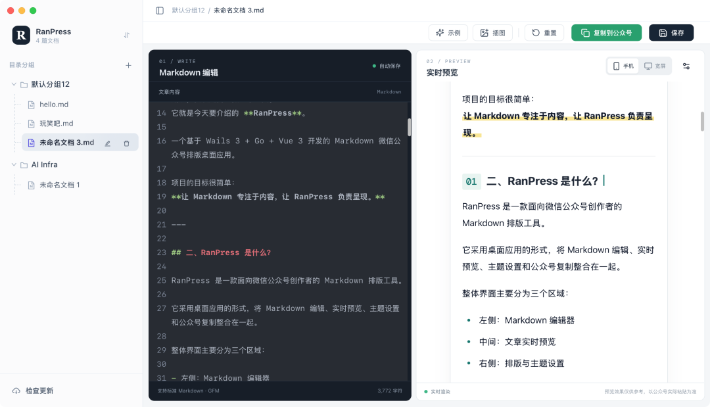

# RanPress

<p align="center">
  <strong>Markdown to WeChat Official Account Formatter</strong>
</p>

<p align="center">
  一款基于 Wails 3 + Go 开发的 Markdown 微信公众号排版工具。
  <br />
  专注于提升 Markdown 写作与微信公众号内容排版效率。
</p>

<p align="center">
  <a href="https://github.com/JinGongX/RanPress">GitHub</a>
  ·
  <a href="https://github.com/JinGongX/RanPress/releases">下载体验</a>
  ·
  <a href="https://github.com/JinGongX/RanPress/issues">问题反馈</a>
</p>

---

## ✨ 为什么选择 RanPress？

写 Markdown 很舒服，但将文章发布到微信公众号，往往还需要处理格式、代码块、图片、引用等问题。

RanPress 希望让这个过程变得简单：

- 专注 Markdown 写作，无需反复调整排版。
- 丰富的主题样式，让文章拥有更好的阅读体验。
- 一键复制排版后的内容，直接粘贴到微信公众号编辑器。
- 本地图片管理，让图片处理更加方便。

**Write in Markdown, Publish to WeChat.**

## 📸 项目截图


<p align="center">
  
</p>

## 🚀 核心功能

### 📝 Markdown 编辑

- 支持常用 Markdown 语法。
- 实时预览编辑效果。
- 编辑与预览相结合，提升写作效率。
- 支持本地图片管理与使用。

### 🎨 微信公众号排版

- 多种文章主题样式。
- 一键转换为微信公众号兼容 HTML。
- 支持标题、段落、列表、引用等常见内容样式。
- 支持提示块与重点内容展示。
- 让 Markdown 内容快速拥有专业的排版效果。

### 💻 代码块美化

面向技术文章提供更好的代码阅读体验：

- 支持多种代码块主题。
- 支持 macOS 风格代码窗口。
- 支持 GitHub 风格代码块。
- 支持 VS Code 风格代码块。

### 🖼 图片管理

- 支持本地图片上传。
- 支持在 Markdown 文档中插入图片。
- 支持图片预览。
- 方便管理文章中的图片资源。

### 👀 多模式预览

- 实时查看 Markdown 渲染效果。
- 支持移动端阅读效果预览。
- 支持宽屏预览。
- 所见即所得，减少反复调整。

### ⚡ 便捷体验

- 一键复制排版后的 HTML。
- 支持应用内检查更新。
- 本地桌面应用，无需依赖在线编辑器。
- 轻量、简洁，专注内容创作。

## 🛠 技术栈

| 技术 | 说明 |
|---|---|
| [Wails 3](https://wails.io/) | 桌面应用框架 |
| [Go](https://go.dev/) | 后端开发语言 |
| [Vue 3](https://vuejs.org/) | 前端框架 |
| [TypeScript](https://www.typescriptlang.org/) | 类型支持 |
| [Tailwind CSS](https://tailwindcss.com/) | UI 样式框架 |
| [Vite](https://vite.dev/) | 前端构建工具 |

## 📦 下载与安装

前往 GitHub Releases 页面下载最新版本：

**[Download RanPress](https://github.com/JinGongX/RanPress/releases)**

根据你的操作系统选择对应安装包。

## 💻 本地开发

### 环境要求

- Go
- Node.js
- Wails 3

### 克隆项目

```bash
//直接拉模版即可
wails3 init -n RanPress -t https://github.com/JinGongX/RanPress

cd RanPress
```

### 安装前端依赖

```bash
cd frontend

npm install
```

### 启动开发环境

根据项目配置使用 Wails 3 启动开发模式：

```bash
wails3 dev
```

### 构建应用

```bash
wails3 build
```

## 🗺 Roadmap

- [x] Markdown 编辑与实时预览
- [x] 微信公众号 HTML 排版
- [x] 多种文章主题
- [x] 代码块样式美化
- [x] 本地图片管理
- [x] 移动端与宽屏预览
- [x] 应用内检查更新
- [ ] 更多排版主题
- [ ] 更多编辑体验优化

## 🤝 参与贡献

欢迎提交 Issue 和 Pull Request，一起完善 RanPress。

如果你在使用过程中遇到问题，或者有新的功能建议，欢迎在 [Issues](https://github.com/JinGongX/RanPress/issues) 中反馈。

## ⭐ Star

如果 RanPress 对你的写作和公众号排版有所帮助，欢迎给项目点一个 Star！

你的支持是持续迭代的动力。

## 📄 License

本项目采用 MIT License，具体以仓库中的 LICENSE 文件为准。